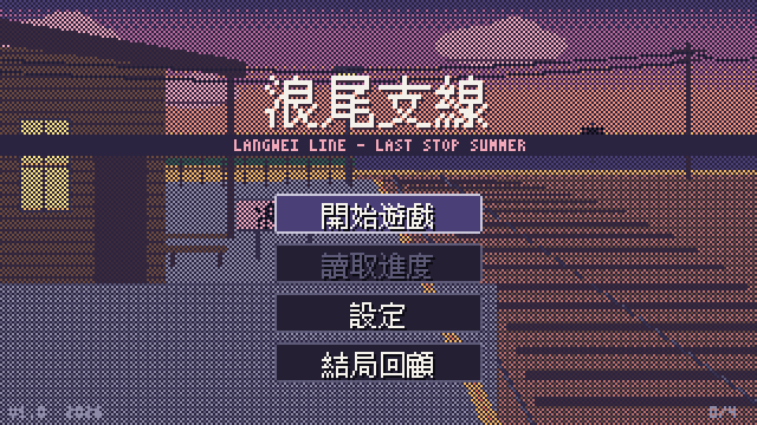

# 浪尾支線 Langwei Line

> 八月底，一條要停駛的支線鐵路，一個不知道自己要什麼的十八歲。

瀏覽器就能玩的像素風 galgame（視覺小說）。320×180 的畫面、32 色調色盤、程序生成的晶片音樂。
美術、音樂、劇本全部從零做，沒有用任何外部素材。



## 怎麼玩

**直接玩**：打開 `dist/index.html`（雙擊就好，不用網路、不用伺服器）。
如果資料夾裡還沒有 `dist/`，先照下面「自己建置」做一次。

| 操作 | 滑鼠／觸控 | 鍵盤 |
| --- | --- | --- |
| 下一句 | 左鍵點畫面、滾輪往下 | Space / Enter / Z |
| 選擇選項 | 點選項 | ↑↓ + Enter，或數字鍵 1–4 |
| 自動播放 | 右下 AUTO | A |
| 快進 | 右下 SKIP | S 切換，按住 Ctrl |
| 回看 | 右下 LOG、滾輪往上 | L |
| 存檔／讀檔 | 右下 SAVE / LOAD | — |
| 設定 | 右下 CONF | — |
| 隱藏對話框 | 右鍵 | H |
| 返回 | 右鍵 | Esc |

- 存檔有 3 欄，存在瀏覽器的 localStorage（同一台電腦、同一個瀏覽器才讀得到）。
- 快進預設只跳過「已經讀過」的句子，設定裡可以改成全部跳過。
- 設定可以調文字速度、自動速度、音樂與音效音量、全螢幕。
- 第一次要點一下畫面才會有聲音（瀏覽器的規定）。

### 遊玩量與結局

一輪大約 50～70 分鐘，全部結局大約 2.5 小時。共有四個結局：

| 結局 | 怎麼到 |
| --- | --- |
| 小滿「第一班車」 | 對小滿好感夠高，廟會那晚等她收攤 |
| 韶「錄音帶的 B 面」 | 對韶好感夠高，廟會那晚去大樹下 |
| 佩「留白」 | 對佩好感夠高，廟會那晚去倉庫 |
| 普通「夏天停靠」 | 一個人逛廟會 |

提示：第二天下雨的那個下午很重要。標題畫面的「結局回顧」會記錄你看過哪些結局。

## 自己建置

需要 Node.js 18 以上。

```bash
npm install
npm run dev      # 開發模式，瀏覽器開 http://localhost:5173
npm run build    # 打包成單一檔案 dist/index.html
npm test         # 劇本測試：所有分支走一遍
npm run shots    # 打包＋用 Playwright 截圖到 screenshots/ 並檢查像素
```

`npm run shots` 需要裝好 Playwright 的 Chromium（`npx playwright install chromium`）。

## 怎麼改劇本

劇本在 `script/*.txt`，用純文字寫，**檔名順序就是載入順序**，標籤在所有檔案之間共用。
改完存檔，`npm run dev` 會自動重新載入；要打包成單一 HTML 就再跑一次 `npm run build`。
**改完一定要跑 `npm test`**，它會告訴你哪裡寫錯、哪個結局走不到。

### 基本格式

```text
// 這是註解

*day1                          ← 標籤（給跳轉用）
@chapter 第一天　8月25日（一）   ← 章節卡，全形空白前後分成兩行顯示
@bg station dusk               ← 換背景：名稱＋時段
@bg street day rain            ← 可以加效果：rain（下雨）、fireworks（煙火）
@music daily                   ← 換音樂；@music stop 停止
@sfx bell                      ← 音效
@show shao normal right        ← 立繪：角色＋表情＋位置（left / center / right）
@hide shao                     ← 收起立繪；@hide all 全部收起
@wait 600                      ← 停頓（毫秒）
@fx shake                      ← 畫面震動；@fx flash 閃白

這一行沒有名字，就是旁白。
韶：有名字和全形冒號，就是台詞。
韶(smile)：括號裡是表情，會順便換立繪的表情。
韶[？？？]：中括號是顯示的名字，還不知道對方名字的時候用。
阿嬤：沒有立繪的配角也可以講話。
```

### 分支

```text
#choice
> 安靜站著，等她弄完 => pro_wait {shao+1}
> 「妳在做什麼？」 => pro_ask
> 只有好感夠才會出現的選項 => sh_start ?shao>=4
> 選完繼續往下讀 => - {flag:spare_tape}
#end

@add xiaoman 1                 ← 好感度加減
@set spare_tape                ← 設旗標；@set !spare_tape 取消
@if shao>=4 && spare_tape => sh_tape_spare   ← 條件跳轉
@jump d1_night                 ← 直接跳轉
@ending shao 錄音帶的 B 面      ← 結局：id＋標題
```

- 選項格式：`> 文字 => 跳去的標籤 {效果} ?條件`，`{}` 和 `?` 都可以省略；標籤寫 `-` 表示選完照順序往下。
- 條件可以用 `>= <= > < == !=` 比數字或比另一個變數，旗標直接寫名字，`!` 是否定，`&&` 連接。
- 好感度變數：`xiaoman`、`shao`、`pei`。旗標名字自己取，小寫英文加底線。

### 可以用的名稱

| 種類 | 名稱 |
| --- | --- |
| 背景 | `train`（車廂，窗外風景會動）、`station`（月台）、`shop`（福興商店）、`street`（老街）、`seawall`（海堤）、`warehouse`（倉庫二樓）、`room`（晏的房間）、`temple`（廟會，只有 night）、`black` |
| 時段 | `day`、`dusk`、`night`（`shop`、`room` 沒有 dusk） |
| 音樂 | `title`、`daily`、`sad`、`night` |
| 音效 | `select`、`bell`（平交道）、`door`（風鈴）、`train`、`tape`（錄音機）、`phone` |
| 小滿表情 | `normal`、`smile`、`shy`、`sad`、`angry` |
| 韶表情 | `normal`、`smile`、`shy`、`sad`、`surprised` |
| 佩表情 | `normal`、`smile`、`shy`、`sad`、`serious` |
| 晏（頭像）表情 | `normal`、`smile`、`troubled`、`surprised` |

新增配角名字要加進 `src/core/cast.ts` 的 `SIDE_NAMES`，不然測試會以為那行是寫錯的旁白。
（例如「她說：……」這種旁白，冒號前面太短會被當成台詞，測試會抓出來。）

## 專案結構

```text
script/            劇本（改這裡）
story/BIBLE.md     角色、世界觀、各路線大綱
ART.md             調色盤與美術規格
src/core/          劇本解析器、VM、換行（純邏輯，Node 也能跑）
src/art/           背景、立繪、特效（全部用程式畫，只用 32 色）
src/audio/         晶片音樂曲譜與 Web Audio 音源
src/ui/font.ts     點陣字
src/game.ts        畫面、對話框、選單、存讀檔
tests/             分支測試與截圖檢查
screenshots/       截圖
dev/               開發用：背景與立繪一覽頁（npm run dev 後開 /dev/preview.html）
```

## 測試在檢查什麼

- `npm test`：解析全部劇本；檢查標籤、背景、表情、音樂名稱都存在；每一句換行後都不會超出對話框；
  然後把所有選項組合（含好感度與旗標）窮舉一遍，確認四個結局都能到達、沒有死路、沒有永遠走不到的句子。
- `npm run shots`：以 3 倍放大截圖，檢查每個邏輯像素都是整齊的 3×3 色塊（沒有模糊、沒有半像素），
  而且畫面上只出現調色盤裡的 32 種顏色；也會測試存檔後讀檔能不能接回去。
